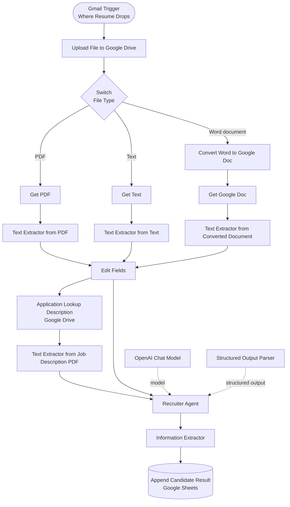

# Advanced Recruitment AI Automation Workflow

An n8n-based recruitment workflow that receives applicant documents, routes supported file types, extracts CV content, retrieves job-description context, processes the information with an AI recruiter agent, and sends structured candidate results to Google Sheets.

**Author:** Okolo Onochie

## Project overview

The workflow is designed to reduce repetitive recruitment administration by automating document intake, file handling, text extraction, AI-assisted candidate processing, and result recording.

## System organogram

The diagram below shows the workflow structure based on the supplied n8n screenshot.

## Technology stack

- n8n — workflow orchestration
- Gmail — incoming application/resume trigger
- Google Drive — applicant document storage and job-description source
- Google Docs — conversion path for Word documents
- OpenAI Chat Model — language model connected to the recruiter agent
- Structured Output Parser — structured agent response
- Google Sheets — candidate result destination

## Workflow stages

1. Receive an applicant email through the configured Gmail trigger.
2. Upload the incoming file to Google Drive.
3. Route the document according to file type.
4. Extract text from PDF and text documents; convert Word documents to Google Docs before extraction.
5. Prepare the extracted candidate information.
6. Retrieve and extract the relevant job/application description.
7. Process the candidate and job context with the AI Recruiter Agent.
8. Format the result through the Structured Output Parser and downstream extraction step.
9. Append the candidate result to Google Sheets.

## Repository map

- `workflows/01-cv-intake-and-screening/` — workflow notes, JSON export location, and screenshots.
- `documentation/` — project overview, architecture, setup, testing, and limitations.
- `diagrams/` — system organogram.

## Current status

The documentation is based on the supplied n8n workflow screenshot. The workflow JSON export, detailed node parameters, exact AI prompt, output schema, sheet columns, and execution evidence have not yet been supplied. These will be added after review rather than assumed.

## Responsible use and security

- Keep a human recruiter responsible for hiring decisions.
- Treat AI-generated candidate summaries as decision support, not final decisions.
- Review outputs for accuracy and potential bias.
- Do not commit credentials, OAuth tokens, private webhook URLs, real CVs, or personal applicant information.
- Use synthetic or consented sample data for portfolio demonstrations.
